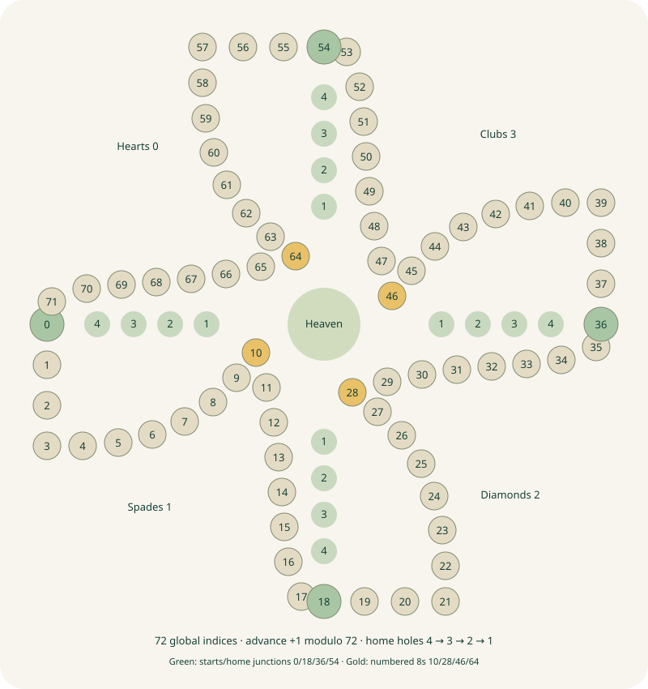

# Approved 72-space board



Geometry references: images/ChatGPT Image Oct 30, 2026, 01_21_37 AM.jpg. Artwork is original; photographs are not served to clients.

Canonical indices increase in the arrow direction and wrap 71→0. Each segment counts down its printed labels, 18→17→…→1. Corner 15 is a single hole with two labels.

| Suit/seat    | Board quadrant | Start / home junction | Numbered 8 | Track segment |
| ------------ | -------------- | --------------------: | ---------: | ------------- |
| Hearts / 0   | Upper left     |         0 (left edge) |         10 | 0–17          |
| Spades / 1   | Lower left     |      18 (bottom edge) |         28 | 18–35         |
| Diamonds / 2 | Lower right    |       36 (right edge) |         46 | 36–53         |
| Clubs / 3    | Upper right    |         54 (top edge) |         64 | 54–71         |

```text
                           Clubs start 54
                                │
                    54…71 ←─────┘
       Hearts start 0             Diamonds start 36
              │                          ↑
              └────→ 0…17        36…53 ───┘
                         Spades start 18
                         18…35 → Diamonds

Canonical cycle: 0 → … → 18 → … → 36 → … → 54 → … → 71 → 0
Each seat's home branch: own start → home slot 0 → 1 → 2 → 3
Printed home numbers:                       4 → 3 → 2 → 1
```

The table and canonical cycle define the approved logical map; the diagram is schematic. Coordinates live in apps/web/src/board/geometry.ts and never affect engine legality. Home entry requires earned circuit eligibility; no home coordinate is part of the shared track. Heaven is one central slot.

Marbles have stable IDs, owner, location, signed net track progress and persistent home eligibility. Capturing resets progress and eligibility. Never infer eligibility from rendered coordinates or a teleport destination.
